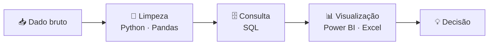

[](https://www.linkedin.com/in/ryancamposs/)
[](#)

</div>

---

## 🧭 Quem sou eu

```python
ryan = {
    "cargo":      "Analista de Dados Júnior",
    "formacao":   "Ciências Contábeis",
    "missao":     "Achar a história escondida dentro da planilha",
    "combustivel": ["coca-cola", "curiosidade", "consultas bem otimizadas"],
    "status":     "se esforçando para aprender algo novo todos os dias ",
}

def sobre_mim():
    return "Gosto de números, mas gosto mais do que eles querem dizer."
```

Formação em contabilidade + olhar analítico: entendo o **negócio por trás do dado**, não só o dado.

---

## 🛠️ Arsenal

<div align="center">

| Ferramenta | Pra que eu uso |
|:---:|:---|
|  | Extrair, juntar e tratar dados direto da fonte |
|  | Análises rápidas, tabelas dinâmicas e fórmulas |
|   | Limpeza, transformação e automação de dados |
|  | Dashboards que contam uma história clara |

</div>

---

## 🔄 Meu fluxo de trabalho



---

## 📊 Dashboards

> Projetos de análise de dados que já estão no ar. Clique para ver o repositório.

| Projeto | O que faz | Stack | Status |
|:---|:---|:---|:---:|
| 🛒 **[Dashboard de Vendas e Devoluções](https://github.com/RyanCamposs/dashboard-vendas-devolucoes)** | Dashboard interativo para analisar vendas, faturamento e devoluções por período, produto e loja. Mostra indicadores estratégicos, tendências, produtos de maior desempenho e pontos de atenção no processo comercial. | `Power BI` |  |

---

## 🎯 Agora

- 🔭 Buscando minha primeira vaga como **Analista de Dados Júnior** (remoto)
- 📚 Aprofundando **SQL avançado** (window functions, CTEs) e **modelagem no Power BI**
- 🤝 Aberto a conversas, mentorias e trocas de ideia sobre dados

---

<div align="center">

### 📫 Vamos conversar?

[](https://www.linkedin.com/in/ryancamposs/)

<sub>*"Sem dados você é só mais uma pessoa com uma opinião."* — W. Edwards Deming</sub>


</div>
